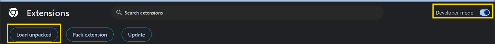
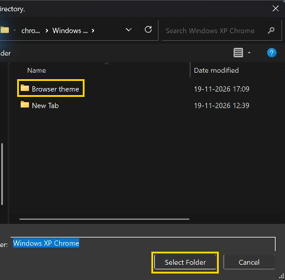
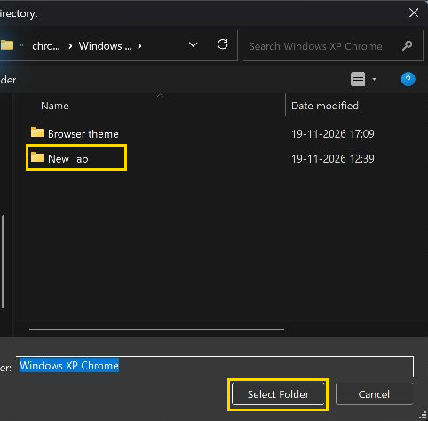

# Windows XP Chrome

Give Chrome a Windows XP look with the **Browser theme**. Add **New Tab** for the Bliss wallpaper, Google search, and editable shortcuts.

## Install in Chrome

If you have the **Windows XP Chrome** ZIP, extract it first. Inside **Windows XP Chrome**, you should see the **Browser theme** and **New Tab** folders. If you downloaded the GitHub source, see [Installing from source](#installing-from-source) for the folder names.

### 1. Open Extensions

Copy `chrome://extensions/` into Chrome’s address bar and press **Enter**.


### 2. Turn on Developer mode

Turn on **Developer mode** in the top-right corner. Then click **Load unpacked** in the top-left corner.



### 3. Load the Browser theme

In the folder picker, open **Windows XP Chrome**, click **Browser theme** once to highlight it, then click **Select Folder**. Chrome applies the theme right away.



### 4. Load New Tab

On the Extensions page, click **Load unpacked** again. In **Windows XP Chrome**, click **New Tab** once to highlight it, then click **Select Folder**.



Open a new tab to see Bliss and the search box. If Chrome asks whether to keep the new page, click **Keep it**.

## Installing from source

If your download contains `theme` and `new-tab`, use the same Chrome steps with these folders.

| Install | Folder to select |
| --- | --- |
| Browser theme | `theme` |
| New Tab | Run `.\build_new_tab.ps1` from the project folder in PowerShell, then select `dist\new-tab`. |

## Manage or remove

- **Shortcuts** — Open **Manage shortcuts → Import** to load an export, or use **Add shortcut** to add a site. Use **Export** to save a backup before removing the extension.
- **New Tab** — Open `chrome://extensions/` and turn off or remove **Luna New Tab** to restore Chrome’s built-in page.
- **Browser theme** — Open `chrome://settings/appearance` and click **Reset to default** next to **Theme**. To update or reinstall the theme, reset it first, then repeat step 3.
- **Bliss wallpaper** — If you’re using only the theme and Bliss is missing, clear any custom background in **Customize Chrome** and open a new tab.

To restore the approved 0.3 theme, download or check out tag `v0.3.0`, reset your current theme, and load the tagged `theme` folder.

## How the theme works

| Surface | Treatment |
| --- | --- |
| Frame and inactive tabs | Glossy royal blue sampled from the Seelen reference. The tab textures use frame blue where the tab outline curves and a beveled face across the straighter middle. Unfocused windows use a quieter blue. |
| Selected tab and toolbar | The shared texture paints a pale rectangular-looking face on the selected tab. Frame blue masks its curved shoulders in the focused window. A separate icy band starts the toolbar. |
| Window controls | Windows Chrome samples a three-slot PNG for compact blue minimize and maximize plates and a red close plate. The plates are positioned behind Chrome's own symbols. |
| New tab button | The native plus button uses the theme's tab-strip palette. Chrome controls its shape and interaction states. |
| Address bar | The manifest requests a white field and dark-blue text. Chrome computes the appearance of the interaction states. |
| New Tab | A centered, full-color photo behind Chrome's standard controls. Chrome displays a theme PNG at its native size and crops it to the window. The bundled image is sized for desktop use, including the reference display at 200% scale. |

Chrome controls the radius of tabs and the omnibox as well as the layout, glyphs,
hit targets, dragging, and security UI. Luna Chrome creates the raised effect with
straight highlights and shading within Chrome's paintable areas.

[Chrome theme reference](https://developer.chrome.com/docs/extensions/develop/ui/themes),
[Chromium tab painting](https://chromium.googlesource.com/chromium/src/+/ca0889d298353d69b923461e06db66f88cb02048/chrome/browser/ui/views/tabs/tab_style_views.cc),
and [Chromium Windows caption painting](https://raw.githubusercontent.com/chromium/chromium/6dc9bc3bdaea5c35ed6d41fceab2f7a3a2227c4f/chrome/browser/ui/views/frame/windows_caption_button.cc).

## Regenerate the artwork

The images are bundled. With Python 3, use `python .\build_assets.py` to rebuild
the frame, tab, toolbar, window-control, and extension icon PNGs. Edit the RGB
stops in the script to adjust the gradients.

To rebuild the wallpaper PNG from your own local source, run this command from
PowerShell. The script scales the photo to 1920 pixels wide and keeps its proportions.

```powershell
.\build_wallpaper.ps1 -SourceImage 'C:\path\to\bliss.jpg'
```

Reset the theme and load the folder again after changing any PNG.
